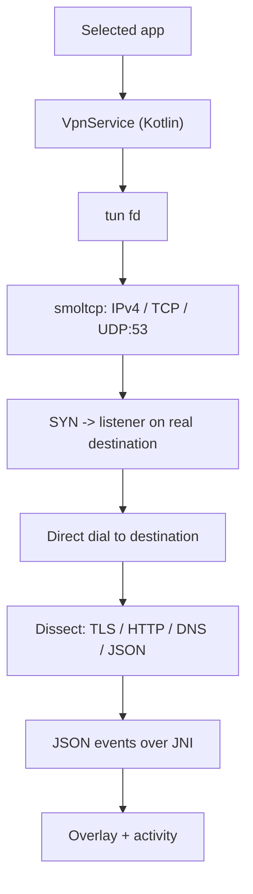
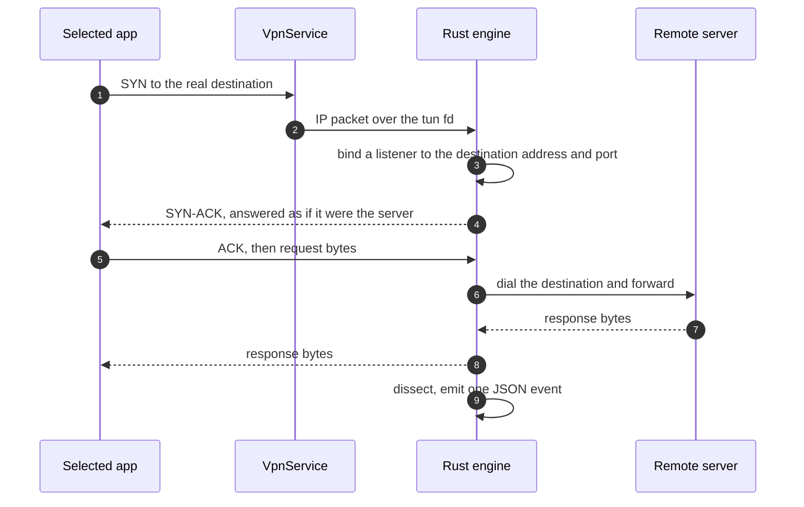

<p align="center">
  
  
  
  
  
  
  
</p>

<p align="center"><b>𝐭𝐮𝐧𝐥𝐞𝐧𝐬</b></p>

<p align="center"><b>𝐕𝐩𝐧𝐒𝐞𝐫𝐯𝐢𝐜𝐞 -> 𝐬𝐦𝐨𝐥𝐭𝐜𝐩 -> 𝐃𝐢𝐫𝐞𝐜𝐭 𝐃𝐢𝐚𝐥 -> 𝐃𝐢𝐬𝐬𝐞𝐜𝐭 -> 𝐉𝐒𝐎𝐍</b></p>

<p align="center"><b>𝐀 𝐫𝐞𝐚𝐝-𝐨𝐧𝐥𝐲 𝐭𝐫𝐚𝐟𝐟𝐢𝐜 𝐨𝐛𝐬𝐞𝐫𝐯𝐞𝐫 𝐟𝐨𝐫 𝐀𝐧𝐝𝐫𝐨𝐢𝐝 𝐚𝐩𝐩𝐬 𝐲𝐨𝐮 𝐨𝐰𝐧</b></p>

<p align="center">
  𝐑𝐮𝐬𝐭 𝐞𝐧𝐠𝐢𝐧𝐞 + 𝐊𝐨𝐭𝐥𝐢𝐧 𝐬𝐡𝐞𝐥𝐥<br>
  𝐍𝐨 𝐩𝐚𝐜𝐤𝐞𝐭 𝐫𝐞𝐰𝐫𝐢𝐭𝐢𝐧𝐠. 𝐍𝐨 𝐤𝐞𝐲 𝐢𝐧𝐣𝐞𝐜𝐭𝐢𝐨𝐧. 𝐍𝐨 𝐜𝐫𝐨𝐬𝐬-𝐚𝐩𝐩 𝐥𝐨𝐠 𝐬𝐜𝐫𝐚𝐩𝐢𝐧𝐠.
</p>

---

## **📖 𝐎𝐯𝐞𝐫𝐯𝐢𝐞𝐰**

𝐭𝐮𝐧𝐥𝐞𝐧𝐬 𝐢𝐬 𝐚 𝐬𝐞𝐥𝐟-𝐜𝐨𝐧𝐭𝐚𝐢𝐧𝐞𝐝 𝐭𝐫𝐚𝐟𝐟𝐢𝐜 𝐢𝐧𝐬𝐩𝐞𝐜𝐭𝐨𝐫 𝐟𝐨𝐫 𝐀𝐧𝐝𝐫𝐨𝐢𝐝. 𝐀 `VpnService` 𝐫𝐨𝐮𝐭𝐞𝐬
𝐨𝐧𝐥𝐲 𝐭𝐡𝐞 𝐚𝐩𝐩𝐬 𝐲𝐨𝐮 𝐩𝐢𝐜𝐤 𝐢𝐧𝐭𝐨 𝐚 𝐮𝐬𝐞𝐫𝐬𝐩𝐚𝐜𝐞 𝐓𝐂𝐏/𝐈𝐏 𝐬𝐭𝐚𝐜𝐤 𝐰𝐫𝐢𝐭𝐭𝐞𝐧 𝐢𝐧 𝐑𝐮𝐬𝐭, 𝐰𝐡𝐢𝐜𝐡 𝐝𝐢𝐚𝐥𝐬
𝐭𝐡𝐞 𝐫𝐞𝐚𝐥 𝐝𝐞𝐬𝐭𝐢𝐧𝐚𝐭𝐢𝐨𝐧, 𝐝𝐢𝐬𝐬𝐞𝐜𝐭𝐬 𝐰𝐡𝐚𝐭 𝐜𝐫𝐨𝐬𝐬𝐞𝐬 𝐢𝐭, 𝐚𝐧𝐝 𝐞𝐦𝐢𝐭𝐬 𝐉𝐒𝐎𝐍 𝐞𝐯𝐞𝐧𝐭𝐬 𝐭𝐨 𝐚 𝐭𝐡𝐢𝐧
𝐊𝐨𝐭𝐥𝐢𝐧 𝐬𝐡𝐞𝐥𝐥.

𝐈𝐭 𝐰𝐚𝐬 𝐫𝐞𝐜𝐨𝐧𝐬𝐭𝐫𝐮𝐜𝐭𝐞𝐝 𝐟𝐫𝐨𝐦 𝐭𝐡𝐞 𝐞𝐧𝐠𝐢𝐧𝐞𝐞𝐫𝐢𝐧𝐠 𝐨𝐟 𝐚𝐧 𝐀𝐧𝐝𝐫𝐨𝐢𝐝 𝐩𝐚𝐜𝐤𝐞𝐭-𝐜𝐚𝐩𝐭𝐮𝐫𝐞 𝐚𝐩𝐩,
𝐦𝐢𝐧𝐮𝐬 𝐭𝐡𝐞 𝐩𝐚𝐫𝐭𝐬 𝐭𝐡𝐚𝐭 𝐦𝐚𝐝𝐞 𝐭𝐡𝐚𝐭 𝐚𝐩𝐩 𝐚 𝐜𝐡𝐞𝐚𝐭. 𝐄𝐯𝐞𝐫𝐲𝐭𝐡𝐢𝐧𝐠 𝐢𝐭 𝐨𝐛𝐬𝐞𝐫𝐯𝐞𝐬 𝐢𝐬 𝐦𝐞𝐭𝐚𝐝𝐚𝐭𝐚
𝐭𝐡𝐚𝐭 𝐢𝐬 𝐚𝐥𝐫𝐞𝐚𝐝𝐲 𝐯𝐢𝐬𝐢𝐛𝐥𝐞 𝐨𝐧 𝐭𝐡𝐞 𝐰𝐢𝐫𝐞: 𝐓𝐋𝐒 𝐒𝐍𝐈 𝐚𝐧𝐝 𝐀𝐋𝐏𝐍, 𝐫𝐞𝐜𝐨𝐫𝐝 𝐭𝐲𝐩𝐞𝐬, 𝐩𝐥𝐚𝐢𝐧𝐭𝐞𝐱𝐭
𝐇𝐓𝐓𝐏, 𝐃𝐍𝐒 𝐪𝐮𝐞𝐬𝐭𝐢𝐨𝐧 𝐧𝐚𝐦𝐞𝐬.

---

## **✨ 𝐂𝐨𝐫𝐞 𝐅𝐞𝐚𝐭𝐮𝐫𝐞𝐬**

| 𝐅𝐞𝐚𝐭𝐮𝐫𝐞 | 𝐃𝐞𝐬𝐜𝐫𝐢𝐩𝐭𝐢𝐨𝐧 |
|---------|-------------|
| 🎯 𝐏𝐞𝐫-𝐚𝐩𝐩 𝐜𝐚𝐩𝐭𝐮𝐫𝐞 | 𝐎𝐧𝐥𝐲 𝐩𝐚𝐜𝐤𝐚𝐠𝐞𝐬 𝐢𝐧 𝐲𝐨𝐮𝐫 𝐚𝐥𝐥𝐨𝐰-𝐥𝐢𝐬𝐭 𝐚𝐫𝐞 𝐫𝐨𝐮𝐭𝐞𝐝 𝐢𝐧𝐭𝐨 𝐭𝐡𝐞 𝐭𝐮𝐧 |
| 🧱 𝐔𝐬𝐞𝐫𝐬𝐩𝐚𝐜𝐞 𝐬𝐭𝐚𝐜𝐤 | 𝐬𝐦𝐨𝐥𝐭𝐜𝐩 𝐭𝐞𝐫𝐦𝐢𝐧𝐚𝐭𝐞𝐬 𝐓𝐂𝐏 𝐢𝐧 𝐩𝐫𝐨𝐜𝐞𝐬𝐬; 𝐧𝐨 𝐫𝐨𝐨𝐭, 𝐧𝐨 𝐢𝐩𝐭𝐚𝐛𝐥𝐞𝐬 |
| 🎭 𝐀𝐧𝐬𝐰𝐞𝐫𝐬 𝐚𝐬 𝐭𝐡𝐞 𝐝𝐞𝐬𝐭𝐢𝐧𝐚𝐭𝐢𝐨𝐧 | 𝐀𝐧𝐲𝐈𝐏 + 𝐚 𝐥𝐢𝐬𝐭𝐞𝐧𝐞𝐫 𝐛𝐨𝐮𝐧𝐝 𝐭𝐨 𝐭𝐡𝐞 𝐫𝐞𝐚𝐥 𝐚𝐝𝐝𝐫𝐞𝐬𝐬, 𝐬𝐨 𝐭𝐡𝐞 𝐚𝐩𝐩'𝐬 𝐡𝐚𝐧𝐝𝐬𝐡𝐚𝐤𝐞 𝐜𝐨𝐦𝐩𝐥𝐞𝐭𝐞𝐬 𝐧𝐨𝐫𝐦𝐚𝐥𝐥𝐲 |
| 🔍 𝐑𝐞𝐚𝐥 𝐝𝐢𝐬𝐬𝐞𝐜𝐭𝐢𝐨𝐧 | 𝐓𝐋𝐒 𝐂𝐥𝐢𝐞𝐧𝐭𝐇𝐞𝐥𝐥𝐨 𝐒𝐍𝐈/𝐀𝐋𝐏𝐍, 𝐓𝐋𝐒 𝐫𝐞𝐜𝐨𝐫𝐝 𝐥𝐚𝐛𝐞𝐥𝐬, 𝐇𝐓𝐓𝐏 𝐫𝐞𝐪𝐮𝐞𝐬𝐭/𝐫𝐞𝐬𝐩𝐨𝐧𝐬𝐞, 𝐃𝐍𝐒 𝐪𝐮𝐞𝐬𝐭𝐢𝐨𝐧, 𝐉𝐒𝐎𝐍 |
| 📉 𝐁𝐨𝐮𝐧𝐝𝐞𝐝 𝐞𝐯𝐞𝐧𝐭𝐬 | 𝟔𝟒 𝐞𝐯𝐞𝐧𝐭𝐬 𝐩𝐞𝐫 𝐟𝐥𝐨𝐰, 𝐜𝐚𝐩𝐩𝐞𝐝 𝐡𝐞𝐱 𝐩𝐫𝐞𝐯𝐢𝐞𝐰, 𝐬𝐨 𝐛𝐮𝐥𝐤 𝐭𝐫𝐚𝐧𝐬𝐟𝐞𝐫𝐬 𝐜𝐚𝐧𝐧𝐨𝐭 𝐟𝐥𝐨𝐨𝐝 𝐭𝐡𝐞 𝐔𝐈 |
| 🌐 𝐃𝐍𝐒 𝐫𝐞𝐥𝐚𝐲 | 𝐐𝐮𝐞𝐫𝐢𝐞𝐬 𝐭𝐨 𝐭𝐡𝐞 𝐚𝐝𝐯𝐞𝐫𝐭𝐢𝐬𝐞𝐝 𝐫𝐞𝐬𝐨𝐥𝐯𝐞𝐫 𝐚𝐫𝐞 𝐫𝐞𝐥𝐚𝐲𝐞𝐝 𝐮𝐩𝐬𝐭𝐫𝐞𝐚𝐦 𝐚𝐧𝐝 𝐫𝐞𝐩𝐨𝐫𝐭𝐞𝐝 𝐛𝐲 𝐧𝐚𝐦𝐞 |
| 🔌 𝐋𝐨𝐜𝐚𝐥 𝐜𝐚𝐩𝐭𝐮𝐫𝐞 𝐩𝐨𝐢𝐧𝐭 | 𝐎𝐩𝐭𝐢𝐨𝐧𝐚𝐥 𝐒𝐎𝐂𝐊𝐒𝟓 𝐥𝐢𝐬𝐭𝐞𝐧𝐞𝐫 𝐟𝐨𝐫 𝐡𝐨𝐬𝐭/𝐂𝐋𝐈 𝐮𝐬𝐞 |
| 🪟 𝐅𝐥𝐨𝐚𝐭𝐢𝐧𝐠 𝐨𝐯𝐞𝐫𝐥𝐚𝐲 | 𝐃𝐫𝐚𝐠-𝐚𝐧𝐲𝐰𝐡𝐞𝐫𝐞 𝐞𝐯𝐞𝐧𝐭 𝐥𝐢𝐬𝐭, 𝐬𝐭𝐫𝐢𝐜𝐭𝐥𝐲 𝐫𝐞𝐧𝐝𝐞𝐫-𝐨𝐧𝐥𝐲 |

---

## **🏗️ 𝐀𝐫𝐜𝐡𝐢𝐭𝐞𝐜𝐭𝐮𝐫𝐞**



---

## **🔁 𝐂𝐨𝐧𝐧𝐞𝐜𝐭𝐢𝐨𝐧 𝐋𝐢𝐟𝐞𝐜𝐲𝐜𝐥𝐞**



---

## **🧪 𝐄𝐧𝐠𝐢𝐧𝐞 𝐁𝐮𝐢𝐥𝐝 𝐚𝐧𝐝 𝐓𝐞𝐬𝐭**

𝐓𝐡𝐞 𝐞𝐧𝐠𝐢𝐧𝐞 𝐛𝐮𝐢𝐥𝐝𝐬 𝐚𝐠𝐚𝐢𝐧𝐬𝐭 𝐭𝐡𝐞 𝐡𝐨𝐬𝐭 𝐀𝐧𝐝𝐫𝐨𝐢𝐝 𝐭𝐚𝐫𝐠𝐞𝐭; 𝐭𝐞𝐬𝐭𝐬 𝐫𝐮𝐧 𝐧𝐚𝐭𝐢𝐯𝐞𝐥𝐲.

```bash
cd rust
cargo build
cargo test                 # 17 tests, including the tun bridge and SOCKS5 relay
cargo run -- version
cargo run -- dissect hex:474554202f70696e6720485454502f312e310d0a486f73743a20636c69656e7462702e6767706f6c6172626561722e636f6d0d0a0d0a
cargo run -- socks --listen 127.0.0.1:1080    # JSON events on stdout
```

`rust/.cargo/config.toml` 𝐢𝐬 𝐡𝐨𝐬𝐭-𝐬𝐩𝐞𝐜𝐢𝐟𝐢𝐜 𝐚𝐧𝐝 𝐠𝐢𝐭-𝐢𝐠𝐧𝐨𝐫𝐞𝐝. 𝐓𝐡𝐞 𝐜𝐨𝐦𝐦𝐢𝐭𝐭𝐞𝐝
𝐭𝐞𝐦𝐩𝐥𝐚𝐭𝐞 𝐢𝐬 `rust/.cargo/config.toml.example`. 𝐑𝐮𝐧 𝐜𝐚𝐫𝐠𝐨 𝐟𝐫𝐨𝐦 𝐢𝐧𝐬𝐢𝐝𝐞 `rust/`,
𝐛𝐞𝐜𝐚𝐮𝐬𝐞 𝐜𝐚𝐫𝐠𝐨 𝐫𝐞𝐚𝐝𝐬 `.cargo/config.toml` 𝐟𝐫𝐨𝐦 𝐭𝐡𝐞 𝐰𝐨𝐫𝐤𝐢𝐧𝐠 𝐝𝐢𝐫𝐞𝐜𝐭𝐨𝐫𝐲, 𝐧𝐨𝐭 𝐟𝐫𝐨𝐦 𝐭𝐡𝐞
𝐦𝐚𝐧𝐢𝐟𝐞𝐬𝐭'𝐬.

---

## **📱 𝐀𝐧𝐝𝐫𝐨𝐢𝐝 𝐀𝐏𝐊**

```bash
export ANDROID_NDK_HOME=$HOME/Android/Sdk/ndk/27.0.12077973
cargo install cargo-ndk            # once
android/build-native.sh            # libtunlens.so -> app/src/main/jniLibs/<abi>/
cd android && gradle assembleDebug
```

`build-native.sh` 𝐭𝐞𝐦𝐩𝐨𝐫𝐚𝐫𝐢𝐥𝐲 𝐦𝐨𝐯𝐞𝐬 𝐭𝐡𝐞 𝐡𝐨𝐬𝐭 𝐜𝐚𝐫𝐠𝐨 𝐜𝐨𝐧𝐟𝐢𝐠 𝐚𝐬𝐢𝐝𝐞 𝐬𝐨 𝐨𝐧𝐥𝐲 𝐭𝐡𝐞 𝐍𝐃𝐊
𝐬𝐲𝐬𝐫𝐨𝐨𝐭 𝐢𝐬 𝐮𝐬𝐞𝐝. 𝐓𝐡𝐞 𝐊𝐨𝐭𝐥𝐢𝐧 𝐮𝐬𝐞𝐬 𝐟𝐫𝐚𝐦𝐞𝐰𝐨𝐫𝐤 𝐀𝐏𝐈𝐬 𝐨𝐧𝐥𝐲, 𝐧𝐨 𝐀𝐧𝐝𝐫𝐨𝐢𝐝𝐗.

𝐓𝐡𝐞 𝐬𝐚𝐦𝐞 𝐬𝐭𝐞𝐩𝐬 𝐫𝐮𝐧 𝐢𝐧 𝐆𝐢𝐭𝐇𝐮𝐛 𝐀𝐜𝐭𝐢𝐨𝐧𝐬 (`.github/workflows/build.yml`): 𝐭𝐡𝐞 𝐑𝐮𝐬𝐭
𝐭𝐞𝐬𝐭𝐬, 𝐭𝐡𝐞 𝐧𝐚𝐭𝐢𝐯𝐞 𝐛𝐮𝐢𝐥𝐝, 𝐚𝐧𝐝 `gradle assembleDebug`, 𝐰𝐢𝐭𝐡 𝐭𝐡𝐞 𝐫𝐞𝐬𝐮𝐥𝐭𝐢𝐧𝐠 𝐀𝐏𝐊
𝐮𝐩𝐥𝐨𝐚𝐝𝐞𝐝 𝐚𝐬 𝐚𝐧 𝐚𝐫𝐭𝐢𝐟𝐚𝐜𝐭. 𝐀 𝐥𝐨𝐜𝐚𝐥 𝐛𝐮𝐢𝐥𝐝 𝐧𝐞𝐞𝐝𝐬 𝐭𝐡𝐞 𝐀𝐧𝐝𝐫𝐨𝐢𝐝 𝐍𝐃𝐊 𝐚𝐧𝐝 𝐆𝐫𝐚𝐝𝐥𝐞 𝐨𝐧
`PATH`; 𝐭𝐡𝐞 𝐰𝐨𝐫𝐤𝐟𝐥𝐨𝐰 𝐢𝐧𝐬𝐭𝐚𝐥𝐥𝐬 𝐛𝐨𝐭𝐡.

### **⚙️ 𝐒𝐞𝐭𝐮𝐩**

𝟏. 𝐎𝐩𝐞𝐧 𝐭𝐮𝐧𝐥𝐞𝐧𝐬, 𝐭𝐚𝐩 **𝐂𝐡𝐨𝐨𝐬𝐞 𝐚𝐩𝐩𝐬**, 𝐭𝐢𝐜𝐤 𝐭𝐡𝐞 𝐚𝐩𝐩𝐬 𝐲𝐨𝐮 𝐨𝐰𝐧.
𝟐. 𝐓𝐚𝐩 **𝐒𝐭𝐚𝐫𝐭 𝐜𝐚𝐩𝐭𝐮𝐫𝐞** 𝐚𝐧𝐝 𝐚𝐜𝐜𝐞𝐩𝐭 𝐭𝐡𝐞 𝐬𝐲𝐬𝐭𝐞𝐦 𝐕𝐏𝐍 𝐜𝐨𝐧𝐬𝐞𝐧𝐭 𝐝𝐢𝐚𝐥𝐨𝐠.
𝟑. 𝐎𝐩𝐭𝐢𝐨𝐧𝐚𝐥: **𝐎𝐯𝐞𝐫𝐥𝐚𝐲** (𝐧𝐞𝐞𝐝𝐬 𝐭𝐡𝐞 𝐝𝐢𝐬𝐩𝐥𝐚𝐲-𝐨𝐯𝐞𝐫-𝐨𝐭𝐡𝐞𝐫-𝐚𝐩𝐩𝐬 𝐩𝐞𝐫𝐦𝐢𝐬𝐬𝐢𝐨𝐧).

---

## **🧾 𝐄𝐯𝐞𝐧𝐭 𝐒𝐜𝐡𝐞𝐦𝐚**

```json
{
  "ts_ms": 1763215541123,
  "host": "clientbp.ggpolarbear.com",
  "port": 443,
  "direction": "client",
  "protocol": "tls",
  "op": "client_hello",
  "summary": "TLS clientbp.ggpolarbear.com (h2)",
  "detail": { "sni": "clientbp.ggpolarbear.com", "alpn": ["h2"], "record_bytes": 517 },
  "raw_hex": "1603010201...",
  "bytes": 517,
  "flow": "10.233.0.2:41234>203.0.113.10:443"
}
```

| 𝐅𝐢𝐞𝐥𝐝 | 𝐌𝐞𝐚𝐧𝐢𝐧𝐠 |
|-------|---------|
| `ts_ms` | 𝐖𝐚𝐥𝐥-𝐜𝐥𝐨𝐜𝐤 𝐭𝐢𝐦𝐞𝐬𝐭𝐚𝐦𝐩 𝐢𝐧 𝐦𝐢𝐥𝐥𝐢𝐬𝐞𝐜𝐨𝐧𝐝𝐬 |
| `host` | 𝐒𝐍𝐈, 𝐇𝐓𝐓𝐏 𝐇𝐨𝐬𝐭, 𝐨𝐫 𝐃𝐍𝐒 𝐧𝐚𝐦𝐞 𝐰𝐡𝐞𝐧 𝐤𝐧𝐨𝐰𝐧, 𝐨𝐭𝐡𝐞𝐫𝐰𝐢𝐬𝐞 𝐭𝐡𝐞 𝐚𝐝𝐝𝐫𝐞𝐬𝐬 |
| `direction` | `client` (𝐚𝐩𝐩 𝐭𝐨 𝐫𝐞𝐦𝐨𝐭𝐞) 𝐨𝐫 `server` (𝐫𝐞𝐦𝐨𝐭𝐞 𝐭𝐨 𝐚𝐩𝐩) |
| `protocol` | `tls`, `http`, `json`, `dns` 𝐨𝐫 `unknown` |
| `op` | 𝐒𝐡𝐨𝐫𝐭 𝐯𝐞𝐫𝐛: `client_hello`, `request`, `response`, `tls_record`, `query` |
| `raw_hex` | 𝐂𝐚𝐩𝐩𝐞𝐝 𝐡𝐞𝐱 𝐩𝐫𝐞𝐯𝐢𝐞𝐰; 𝐭𝐡𝐞 𝐚𝐮𝐭𝐡𝐨𝐫𝐢𝐭𝐚𝐭𝐢𝐯𝐞 𝐫𝐞𝐜𝐨𝐫𝐝 𝐨𝐟 𝐭𝐡𝐞 𝐛𝐲𝐭𝐞𝐬 |
| `flow` | 𝐂𝐥𝐢𝐞𝐧𝐭 𝐚𝐧𝐝 𝐫𝐞𝐦𝐨𝐭𝐞 𝐞𝐧𝐝𝐩𝐨𝐢𝐧𝐭𝐬 𝐟𝐨𝐫 𝐭𝐡𝐢𝐬 𝐜𝐨𝐧𝐧𝐞𝐜𝐭𝐢𝐨𝐧 |

𝐀 𝐩𝐚𝐲𝐥𝐨𝐚𝐝 𝐢𝐬 𝐨𝐧𝐥𝐲 𝐥𝐚𝐛𝐞𝐥𝐥𝐞𝐝 𝐰𝐡𝐞𝐧 𝐢𝐭 𝐚𝐜𝐭𝐮𝐚𝐥𝐥𝐲 𝐩𝐚𝐫𝐬𝐞𝐬. 𝐔𝐧𝐩𝐚𝐫𝐬𝐚𝐛𝐥𝐞 𝐛𝐲𝐭𝐞𝐬 𝐬𝐭𝐚𝐲
`unknown` 𝐢𝐧𝐬𝐭𝐞𝐚𝐝 𝐨𝐟 𝐛𝐞𝐢𝐧𝐠 𝐠𝐮𝐞𝐬𝐬𝐞𝐝 𝐟𝐫𝐨𝐦 𝐭𝐡𝐞 𝐩𝐨𝐫𝐭 𝐧𝐮𝐦𝐛𝐞𝐫.

𝐓𝐡𝐞 𝐞𝐱𝐚𝐦𝐩𝐥𝐞 𝐚𝐛𝐨𝐯𝐞 𝐮𝐬𝐞𝐬 𝐭𝐡𝐞 𝐨𝐫𝐢𝐠𝐢𝐧𝐚𝐥 𝐚𝐩𝐩'𝐬 𝐫𝐞𝐚𝐥 𝐀𝐏𝐈 𝐡𝐨𝐬𝐭, 𝐰𝐡𝐢𝐜𝐡 𝐢𝐬 𝐚𝐥𝐬𝐨 𝐰𝐡𝐚𝐭 𝐭𝐡𝐞
𝐭𝐞𝐬𝐭 𝐟𝐢𝐱𝐭𝐮𝐫𝐞𝐬 𝐮𝐬𝐞. 𝐓𝐡𝐨𝐬𝐞 𝐧𝐚𝐦𝐞𝐬 𝐚𝐫𝐞 𝐢𝐧𝐞𝐫𝐭 𝐬𝐭𝐫𝐢𝐧𝐠𝐬: 𝐞𝐯𝐞𝐫𝐲 𝐭𝐞𝐬𝐭 𝐝𝐢𝐚𝐥𝐬 `127.0.0.1`,
𝐬𝐨 𝐧𝐨𝐭𝐡𝐢𝐧𝐠 𝐢𝐬 𝐞𝐯𝐞𝐫 𝐫𝐞𝐬𝐨𝐥𝐯𝐞𝐝 𝐨𝐫 𝐜𝐨𝐧𝐭𝐚𝐜𝐭𝐞𝐝. 𝐀𝐝𝐝𝐫𝐞𝐬𝐬𝐞𝐬 𝐢𝐧 𝐟𝐢𝐱𝐭𝐮𝐫𝐞𝐬 𝐜𝐨𝐦𝐞 𝐟𝐫𝐨𝐦 𝐭𝐡𝐞
𝐝𝐨𝐜𝐮𝐦𝐞𝐧𝐭𝐚𝐭𝐢𝐨𝐧 𝐫𝐚𝐧𝐠𝐞 `203.0.113.0/24`.

---

## **🛠️ 𝐓𝐞𝐜𝐡𝐧𝐨𝐥𝐨𝐠𝐲 𝐒𝐭𝐚𝐜𝐤**

| 𝐋𝐚𝐲𝐞𝐫 | 𝐓𝐞𝐜𝐡𝐧𝐨𝐥𝐨𝐠𝐲 |
|-------|------------|
| 𝐄𝐧𝐠𝐢𝐧𝐞 | 𝐑𝐮𝐬𝐭 𝟐𝟎𝟐𝟏, `smoltcp` 𝟎.𝟏𝟎, `jni` 𝟎.𝟐𝟏 |
| 𝐃𝐢𝐬𝐬𝐞𝐜𝐭𝐢𝐨𝐧 | 𝐇𝐚𝐧𝐝-𝐫𝐨𝐥𝐥𝐞𝐝 𝐓𝐋𝐒 𝐩𝐚𝐫𝐬𝐞𝐫, `httparse`, `serde_json` |
| 𝐀𝐧𝐝𝐫𝐨𝐢𝐝 𝐬𝐡𝐞𝐥𝐥 | 𝐊𝐨𝐭𝐥𝐢𝐧, 𝐟𝐫𝐚𝐦𝐞𝐰𝐨𝐫𝐤 `VpnService` 𝐚𝐧𝐝 `WindowManager` |
| 𝐁𝐫𝐢𝐝𝐠𝐞 | 𝐉𝐍𝐈, `libtunlens.so` 𝐯𝐢𝐚 𝐜𝐚𝐫𝐠𝐨-𝐧𝐝𝐤 |
| 𝐂𝐚𝐩𝐭𝐮𝐫𝐞 𝐩𝐨𝐢𝐧𝐭 | 𝐒𝐎𝐂𝐊𝐒𝟓 (𝐡𝐨𝐬𝐭 𝐮𝐬𝐞) 𝐚𝐧𝐝 𝐭𝐡𝐞 𝐭𝐮𝐧 𝐛𝐫𝐢𝐝𝐠𝐞 (𝐨𝐧 𝐝𝐞𝐯𝐢𝐜𝐞) |
| 𝐎𝐮𝐭𝐩𝐮𝐭 | 𝐍𝐞𝐰𝐥𝐢𝐧𝐞-𝐟𝐫𝐞𝐞 𝐉𝐒𝐎𝐍 𝐞𝐯𝐞𝐧𝐭𝐬, 𝐨𝐧𝐞 𝐩𝐞𝐫 𝐨𝐛𝐬𝐞𝐫𝐯𝐚𝐭𝐢𝐨𝐧 |

---

## **📌 𝐃𝐞𝐬𝐢𝐠𝐧 𝐏𝐡𝐢𝐥𝐨𝐬𝐨𝐩𝐡𝐲**

𝐭𝐮𝐧𝐥𝐞𝐧𝐬 𝐢𝐬 𝐛𝐮𝐢𝐥𝐭 𝐚𝐫𝐨𝐮𝐧𝐝 𝐭𝐡𝐫𝐞𝐞 𝐩𝐫𝐢𝐧𝐜𝐢𝐩𝐥𝐞𝐬:

- **𝐑𝐞𝐚𝐝-𝐨𝐧𝐥𝐲 𝐛𝐲 𝐜𝐨𝐧𝐬𝐭𝐫𝐮𝐜𝐭𝐢𝐨𝐧** — 𝐭𝐡𝐞 𝐛𝐫𝐢𝐝𝐠𝐞 𝐞𝐱𝐩𝐨𝐬𝐞𝐬 𝐧𝐨 𝐀𝐏𝐈 𝐭𝐡𝐚𝐭 𝐜𝐚𝐧 𝐚𝐥𝐭𝐞𝐫 𝐚 𝐩𝐚𝐲𝐥𝐨𝐚𝐝
- **𝐒𝐜𝐨𝐩𝐞 𝐛𝐲 𝐟𝐫𝐚𝐦𝐞𝐰𝐨𝐫𝐤** — 𝐨𝐧𝐥𝐲 𝐞𝐱𝐩𝐥𝐢𝐜𝐢𝐭𝐥𝐲 𝐚𝐥𝐥𝐨𝐰𝐞𝐝 𝐩𝐚𝐜𝐤𝐚𝐠𝐞𝐬 𝐞𝐧𝐭𝐞𝐫 𝐭𝐡𝐞 𝐭𝐮𝐧; 𝐚𝐧 𝐞𝐦𝐩𝐭𝐲 𝐬𝐞𝐥𝐞𝐜𝐭𝐢𝐨𝐧 𝐫𝐞𝐟𝐮𝐬𝐞𝐬 𝐭𝐨 𝐬𝐭𝐚𝐫𝐭
- **𝐄𝐯𝐢𝐝𝐞𝐧𝐜𝐞 𝐨𝐯𝐞𝐫 𝐠𝐮𝐞𝐬𝐬𝐞𝐬** — 𝐮𝐧𝐩𝐚𝐫𝐬𝐚𝐛𝐥𝐞 𝐛𝐲𝐭𝐞𝐬 𝐚𝐫𝐞 𝐫𝐞𝐩𝐨𝐫𝐭𝐞𝐝 𝐚𝐬 𝐮𝐧𝐤𝐧𝐨𝐰𝐧, 𝐧𝐞𝐯𝐞𝐫 𝐜𝐨𝐞𝐫𝐜𝐞𝐝 𝐢𝐧𝐭𝐨 𝐚 𝐩𝐫𝐨𝐭𝐨𝐜𝐨𝐥

---

## **⚠️ 𝐒𝐜𝐨𝐩𝐞 𝐚𝐧𝐝 𝐁𝐨𝐮𝐧𝐝𝐚𝐫𝐢𝐞𝐬**

𝐓𝐡𝐞 𝐨𝐫𝐢𝐠𝐢𝐧𝐚𝐥 𝐚𝐩𝐩 𝐚𝐥𝐬𝐨 𝐬𝐜𝐫𝐚𝐩𝐞𝐝 𝐅𝐫𝐞𝐞 𝐅𝐢𝐫𝐞'𝐬 𝐀𝐄𝐒 𝐤𝐞𝐲 𝐚𝐧𝐝 𝐈𝐕 𝐟𝐫𝐨𝐦 𝐢𝐭𝐬 𝐥𝐨𝐠𝐜𝐚𝐭 𝐭𝐡𝐫𝐨𝐮𝐠𝐡 𝐚
𝐒𝐡𝐢𝐳𝐮𝐤𝐮 𝐬𝐡𝐞𝐥𝐥 𝐬𝐞𝐫𝐯𝐢𝐜𝐞, 𝐚𝐧𝐝 𝐫𝐞-𝐢𝐧𝐣𝐞𝐜𝐭𝐞𝐝 𝐞𝐝𝐢𝐭𝐞𝐝 𝐩𝐚𝐜𝐤𝐞𝐭𝐬 𝐢𝐧𝐭𝐨 𝐚 𝐥𝐢𝐯𝐞 𝐬𝐞𝐬𝐬𝐢𝐨𝐧. 𝐁𝐨𝐭𝐡
𝐚𝐫𝐞 𝐚𝐛𝐬𝐞𝐧𝐭 𝐡𝐞𝐫𝐞 𝐛𝐲 𝐝𝐞𝐬𝐢𝐠𝐧.

| 𝐎𝐫𝐢𝐠𝐢𝐧𝐚𝐥 𝐜𝐚𝐩𝐚𝐛𝐢𝐥𝐢𝐭𝐲 | 𝐭𝐮𝐧𝐥𝐞𝐧𝐬 |
|---------------------|---------|
| `setKey` 𝐟𝐫𝐨𝐦 𝐚𝐧𝐨𝐭𝐡𝐞𝐫 𝐚𝐩𝐩'𝐬 𝐥𝐨𝐠𝐬 | 𝐍𝐨 𝐤𝐞𝐲 𝐢𝐧𝐣𝐞𝐜𝐭𝐢𝐨𝐧; 𝐲𝐨𝐮 𝐬𝐞𝐞 𝐨𝐧𝐥𝐲 𝐰𝐡𝐚𝐭 𝐜𝐫𝐨𝐬𝐬𝐞𝐬 𝐲𝐨𝐮𝐫 𝐝𝐞𝐯𝐢𝐜𝐞'𝐬 𝐭𝐮𝐧 |
| `editAndSendDetailed` | 𝐍𝐨 𝐰𝐫𝐢𝐭𝐞 𝐩𝐚𝐭𝐡 𝐚𝐭 𝐚𝐥𝐥 |
| 𝐒𝐡𝐢𝐳𝐮𝐤𝐮 𝐜𝐫𝐨𝐬𝐬-𝐚𝐩𝐩 𝐥𝐨𝐠 𝐫𝐞𝐚𝐝𝐢𝐧𝐠 | 𝐍𝐨𝐭 𝐮𝐬𝐞𝐝; 𝐧𝐨 𝐬𝐡𝐞𝐥𝐥 𝐬𝐞𝐫𝐯𝐢𝐜𝐞, 𝐧𝐨 `QUERY_ALL_PACKAGES` |
| 𝐒𝐢𝐠𝐧𝐚𝐭𝐮𝐫𝐞 𝐠𝐚𝐭𝐞 𝐢𝐧 𝐧𝐚𝐭𝐢𝐯𝐞 𝐜𝐨𝐝𝐞 | 𝐍𝐨𝐧𝐞 |
| 𝐑𝐞𝐰𝐫𝐢𝐭𝐞𝐬 𝐭𝐡𝐞 𝐥𝐨𝐠𝐢𝐧 𝐔𝐑𝐋 𝐭𝐨 `127.0.0.1:8080` | 𝐃𝐢𝐚𝐥𝐬 𝐞𝐱𝐚𝐜𝐭𝐥𝐲 𝐰𝐡𝐚𝐭 𝐭𝐡𝐞 𝐜𝐚𝐩𝐭𝐮𝐫𝐞𝐝 𝐚𝐩𝐩 𝐝𝐢𝐚𝐥𝐥𝐞𝐝 |

𝐃𝐞𝐭𝐚𝐢𝐥𝐬 𝐨𝐟 𝐭𝐡𝐞 𝐨𝐫𝐢𝐠𝐢𝐧𝐚𝐥 𝐚𝐫𝐭𝐢𝐟𝐚𝐜𝐭, 𝐢𝐭𝐬 𝐞𝐧𝐝𝐩𝐨𝐢𝐧𝐭𝐬 𝐚𝐧𝐝 𝐭𝐡𝐞 𝐟𝐮𝐥𝐥 𝐨𝐦𝐢𝐬𝐬𝐢𝐨𝐧 𝐥𝐢𝐬𝐭 𝐚𝐫𝐞 𝐢𝐧
[`docs/provenance.md`](docs/provenance.md).

---

## **✅ 𝐕𝐞𝐫𝐢𝐟𝐢𝐞𝐝**

- `cargo test`: 𝟏𝟕 𝐩𝐚𝐬𝐬𝐢𝐧𝐠, 𝐢𝐧𝐜𝐥𝐮𝐝𝐢𝐧𝐠 𝐚𝐧 𝐢𝐧𝐭𝐞𝐠𝐫𝐚𝐭𝐢𝐨𝐧 𝐭𝐞𝐬𝐭 𝐭𝐡𝐚𝐭 𝐝𝐫𝐢𝐯𝐞𝐬 𝐭𝐡𝐞 𝐫𝐞𝐚𝐥 𝐭𝐮𝐧 𝐛𝐫𝐢𝐝𝐠𝐞 𝐨𝐯𝐞𝐫 𝐚 𝐝𝐚𝐭𝐚𝐠𝐫𝐚𝐦 𝐬𝐨𝐜𝐤𝐞𝐭 𝐩𝐚𝐢𝐫: 𝐒𝐘𝐍, 𝐒𝐘𝐍-𝐀𝐂𝐊 𝐚𝐧𝐬𝐰𝐞𝐫𝐞𝐝 𝐚𝐬 𝐭𝐡𝐞 𝐝𝐞𝐬𝐭𝐢𝐧𝐚𝐭𝐢𝐨𝐧, 𝐡𝐚𝐧𝐝𝐬𝐡𝐚𝐤𝐞, 𝐫𝐞𝐪𝐮𝐞𝐬𝐭 𝐫𝐞𝐥𝐚𝐲𝐞𝐝 𝐭𝐨 𝐚 𝐥𝐨𝐨𝐩𝐛𝐚𝐜𝐤 𝐨𝐫𝐢𝐠𝐢𝐧, 𝐫𝐞𝐬𝐩𝐨𝐧𝐬𝐞 𝐫𝐞𝐥𝐚𝐲𝐞𝐝 𝐛𝐚𝐜𝐤.
- 𝐃𝐍𝐒 𝐭𝐞𝐬𝐭 𝐰𝐢𝐭𝐡 𝐚 𝐬𝐭𝐚𝐧𝐝-𝐢𝐧 𝐫𝐞𝐬𝐨𝐥𝐯𝐞𝐫: 𝐜𝐡𝐞𝐜𝐤𝐬𝐮𝐦-𝐜𝐨𝐫𝐫𝐞𝐜𝐭 𝐪𝐮𝐞𝐫𝐲, 𝐫𝐞𝐥𝐚𝐲𝐞𝐝 𝐚𝐧𝐬𝐰𝐞𝐫, 𝐭𝐫𝐚𝐧𝐬𝐚𝐜𝐭𝐢𝐨𝐧 𝐈𝐃 𝐩𝐫𝐞𝐬𝐞𝐫𝐯𝐞𝐝, 𝐧𝐚𝐦𝐞 𝐫𝐞𝐩𝐨𝐫𝐭𝐞𝐝.
- 𝐄𝐧𝐝-𝐭𝐨-𝐞𝐧𝐝 𝐒𝐎𝐂𝐊𝐒𝟓 𝐫𝐮𝐧 𝐚𝐠𝐚𝐢𝐧𝐬𝐭 𝐥𝐨𝐜𝐚𝐥 𝐇𝐓𝐓𝐏 𝐚𝐧𝐝 𝐓𝐋𝐒 𝐨𝐫𝐢𝐠𝐢𝐧𝐬: 𝐫𝐞𝐪𝐮𝐞𝐬𝐭 𝐝𝐢𝐬𝐬𝐞𝐜𝐭𝐞𝐝, 𝐫𝐞𝐚𝐥 `openssl` 𝐂𝐥𝐢𝐞𝐧𝐭𝐇𝐞𝐥𝐥𝐨 𝐫𝐞𝐩𝐨𝐫𝐭𝐞𝐝 𝐚𝐬 `TLS loginbp.ggpolarbear.com (h2)`, 𝐬𝐞𝐫𝐯𝐞𝐫 𝐫𝐞𝐜𝐨𝐫𝐝𝐬 𝐥𝐚𝐛𝐞𝐥𝐥𝐞𝐝.
- `libtunlens.so` 𝐞𝐱𝐩𝐨𝐫𝐭𝐬 𝐚𝐥𝐥 𝐧𝐢𝐧𝐞 `Java_dev_tunlens_NativeBridge_*` 𝐬𝐲𝐦𝐛𝐨𝐥𝐬, 𝐦𝐚𝐭𝐜𝐡𝐢𝐧𝐠 𝐭𝐡𝐞 𝐊𝐨𝐭𝐥𝐢𝐧 𝐞𝐱𝐭𝐞𝐫𝐧𝐚𝐥𝐬 𝐞𝐱𝐚𝐜𝐭𝐥𝐲.

---

## **🗺️ 𝐑𝐨𝐚𝐝𝐦𝐚𝐩**

- 𝐩𝐜𝐚𝐩 𝐚𝐧𝐝 𝐇𝐀𝐑 𝐞𝐱𝐩𝐨𝐫𝐭 𝐟𝐫𝐨𝐦 𝐭𝐡𝐞 𝐞𝐯𝐞𝐧𝐭 𝐬𝐭𝐫𝐞𝐚𝐦
- 𝐐𝐔𝐈𝐂 𝐦𝐞𝐭𝐚𝐝𝐚𝐭𝐚: 𝐈𝐧𝐢𝐭𝐢𝐚𝐥 𝐩𝐚𝐜𝐤𝐞𝐭 𝐒𝐍𝐈 𝐯𝐢𝐚 𝐭𝐡𝐞 𝐓𝐋𝐒 𝐂𝐥𝐢𝐞𝐧𝐭𝐇𝐞𝐥𝐥𝐨 𝐢𝐧𝐬𝐢𝐝𝐞
- 𝐎𝐩𝐭𝐢𝐨𝐧𝐚𝐥 𝐮𝐬𝐞𝐫-𝐢𝐧𝐬𝐭𝐚𝐥𝐥𝐞𝐝 𝐂𝐀 𝐟𝐨𝐫 𝐞𝐱𝐩𝐥𝐢𝐜𝐢𝐭 𝐝𝐞𝐜𝐫𝐲𝐩𝐭𝐢𝐨𝐧
- 𝐈𝐏𝐯𝟔 𝐭𝐮𝐧 𝐚𝐝𝐝𝐫𝐞𝐬𝐬 𝐚𝐧𝐝 𝐟𝐨𝐫𝐰𝐚𝐫𝐝𝐢𝐧𝐠
- 𝐍𝐨𝐧-𝐃𝐍𝐒 𝐔𝐃𝐏 𝐟𝐨𝐫𝐰𝐚𝐫𝐝𝐢𝐧𝐠

---

## **⚠️ 𝐃𝐢𝐬𝐜𝐥𝐚𝐢𝐦𝐞𝐫**

**𝐅𝐨𝐫 𝐥𝐚𝐰𝐟𝐮𝐥 𝐮𝐬𝐞 𝐨𝐧 𝐚𝐩𝐩𝐬 𝐲𝐨𝐮 𝐨𝐰𝐧 𝐨𝐫 𝐚𝐫𝐞 𝐚𝐮𝐭𝐡𝐨𝐫𝐢𝐬𝐞𝐝 𝐭𝐨 𝐭𝐞𝐬𝐭.**

𝐘𝐨𝐮 𝐚𝐫𝐞 𝐬𝐨𝐥𝐞𝐥𝐲 𝐫𝐞𝐬𝐩𝐨𝐧𝐬𝐢𝐛𝐥𝐞 𝐟𝐨𝐫 𝐜𝐨𝐦𝐩𝐥𝐢𝐚𝐧𝐜𝐞 𝐰𝐢𝐭𝐡 𝐚𝐥𝐥 𝐚𝐩𝐩𝐥𝐢𝐜𝐚𝐛𝐥𝐞 𝐥𝐨𝐜𝐚𝐥, 𝐧𝐚𝐭𝐢𝐨𝐧𝐚𝐥 𝐚𝐧𝐝
𝐢𝐧𝐭𝐞𝐫𝐧𝐚𝐭𝐢𝐨𝐧𝐚𝐥 𝐥𝐚𝐰𝐬. 𝐃𝐨 𝐧𝐨𝐭 𝐮𝐬𝐞 𝐭𝐡𝐢𝐬 𝐭𝐨𝐨𝐥 𝐭𝐨 𝐜𝐚𝐩𝐭𝐮𝐫𝐞 𝐨𝐭𝐡𝐞𝐫 𝐩𝐞𝐨𝐩𝐥𝐞'𝐬 𝐭𝐫𝐚𝐟𝐟𝐢𝐜, 𝐨𝐫 𝐭𝐨
𝐭𝐚𝐦𝐩𝐞𝐫 𝐰𝐢𝐭𝐡 𝐚 𝐠𝐚𝐦𝐞 𝐨𝐫 𝐚𝐧𝐲 𝐭𝐡𝐢𝐫𝐝-𝐩𝐚𝐫𝐭𝐲 𝐬𝐞𝐫𝐯𝐢𝐜𝐞.

---

## **📜 𝐋𝐢𝐜𝐞𝐧𝐬𝐞**

**𝐌𝐈𝐓 𝐋𝐢𝐜𝐞𝐧𝐬𝐞**

𝐒𝐞𝐞 [𝐋𝐈𝐂𝐄𝐍𝐒𝐄](LICENSE) 𝐟𝐨𝐫 𝐭𝐡𝐞 𝐟𝐮𝐥𝐥 𝐭𝐞𝐱𝐭.

---

<p align="center">
  <b>𝐭𝐮𝐧𝐥𝐞𝐧𝐬</b><br>
  𝐕𝐩𝐧𝐒𝐞𝐫𝐯𝐢𝐜𝐞 -> 𝐒𝐭𝐚𝐜𝐤 -> 𝐃𝐢𝐚𝐥 -> 𝐃𝐢𝐬𝐬𝐞𝐜𝐭 -> 𝐉𝐒𝐎𝐍
</p>
